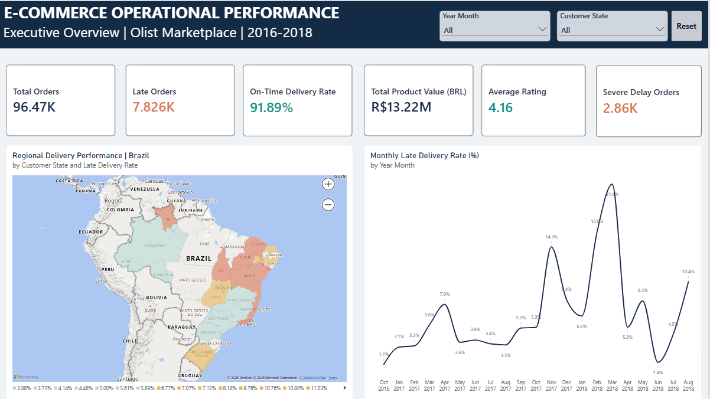
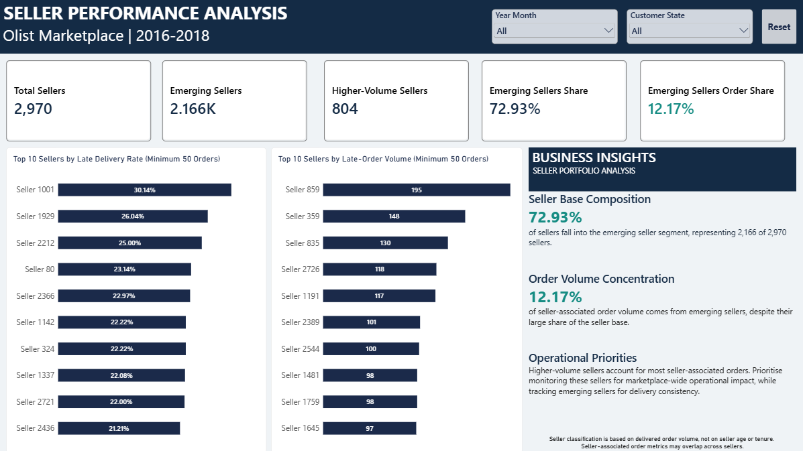
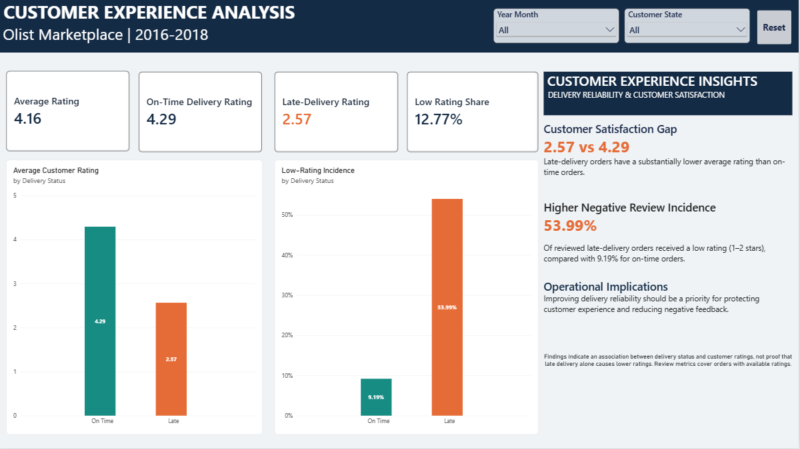

# Olist E-commerce Operational Performance & Customer Experience Analytics

An end-to-end analytics project using the public Olist Brazilian e-commerce dataset (2016–2018). The project investigates delivery reliability, customer experience, seller and category patterns, and the product value associated with delayed orders.

## Business problem

**How can an e-commerce marketplace improve delivery reliability and customer experience while reducing operational inefficiencies and protecting revenue?**

The analysis establishes a delivery-performance baseline, identifies where late deliveries are more prevalent, evaluates the association between delivery status and customer reviews, and translates the findings into operational recommendations.

## Dashboard preview

The Power BI report contains three pages. Open the screenshots below for a quick overview, or download the editable report.

### 1. Executive Overview

### 2. Seller Performance

### 3. Customer Experience

**[Download the Power BI dashboard](./powerbi/Olist_Dashboard.pbix)**

## Key results

The core analysis population includes delivered orders with both a valid delivered timestamp and estimated delivery timestamp.

| Metric | Result |
|---|---:|
| Qualifying delivered orders | 96,470 |
| On-time orders | 88,644 (91.89%) |
| Late orders | 7,826 (8.11%) |
| Severe delays (more than 7 days) | 2,862 |
| Total product value | R$13,220,248.93 |
| Product value associated with late orders | R$1,158,920.51 (8.77%) |
| Average order review score | 4.16 / 5 |
| Qualifying sellers | 2,970 |

**Interpretation:** Product value associated with late orders is an exposure measure based on item price, excluding freight. It is not proof of lost revenue.

## Main findings

- 8.11% of qualifying delivered orders arrived after the estimated delivery date.
- 2,862 qualifying orders were delivered more than seven days after the estimate.
- Late orders were associated with a lower average review score: 2.57 compared with 4.29 for on-time orders.
- Among orders with an available review, 53.99% of late orders received an average score of 2 or below, compared with 9.19% of on-time orders.
- Delivery performance varied across destination states, sellers and product categories.
- Repeat purchasing is uncommon in this dataset; retention comparisons are exploratory and should not be interpreted causally.

## Methodology: Lean Six Sigma DMAIC

| Phase | Application in this project |
|---|---|
| **Define** | Frame late delivery as the operational problem; define the business question, scope and exclusions. |
| **Measure** | Establish baseline delivery, severe-delay, customer-rating and product-value metrics. |
| **Analyze** | Examine patterns over time and across destination states, sellers and product categories; compare review scores by delivery status. |
| **Improve** | Recommend targeted severe-delay intervention, seller monitoring, geographic investigation and proactive customer communication. |
| **Control** | Propose ongoing monitoring of late-delivery rate, severe-delay rate, seller performance and customer ratings. |

## Tools and workflow

**Tools:** Python, pandas, NumPy, MySQL 8.0+, SQL and Power BI.

1. **Python data audit:** inspect source-table structure, missing values, duplicate rows, identifier candidates and table relationships.
2. **SQL analysis:** standardize order dates, validate relationships and data quality, calculate performance metrics, and build analytical views.
3. **Power BI:** communicate findings through Executive Overview, Seller Performance and Customer Experience pages.
4. **DMAIC recommendations:** translate descriptive findings into prioritized operational actions and monitoring metrics.

## Repository contents

| Path | Description |
|---|---|
| [data/](./data/README.md) | Dataset source, nine-table description and local data setup |
| [notebooks/](./notebooks/README.md) | Three ordered Python data-audit notebooks |
| [sql/](./sql/README.md) | MySQL analysis script and execution notes |
| [powerbi/](./powerbi/README.md) | Final three-page Power BI report |
| [images/](./images/README.md) | Dashboard page screenshots |
| [reports/](./reports/README.md) | One-page project summary PDF |
| [docs/PROJECT_SETUP.md](./docs/PROJECT_SETUP.md) | Environment setup and reproduction instructions |
| [docs/KPI_Dictionary.md](./docs/KPI_Dictionary.md) | KPI formulas, populations and interpretation notes |
| [requirements.txt](./requirements.txt) | Python dependencies |

## Getting started

1. Download the nine source CSVs using the link in [data/README.md](./data/README.md). The raw data is not stored in this repository.
2. Follow [the setup guide](./docs/PROJECT_SETUP.md) to prepare Python and MySQL.
3. Run the notebooks in order, then execute the SQL analysis after importing the nine source tables.
4. Open the [Power BI report](./powerbi/Olist_Dashboard.pbix) to explore the final dashboard.

## Recommendations

1. Prioritize investigation of orders with severe delivery delays.
2. Monitor seller performance using both late-delivery rate and order volume; a high rate on a small order base should be interpreted carefully.
3. Investigate destination-state and product-category patterns to identify where additional operational review may be useful.
4. Improve proactive customer communication when an order is at risk of missing its estimate.
5. Track delivery and customer-experience KPIs consistently over time.

## Limitations

- The dataset is observational. The analysis identifies associations and patterns, not causal effects.
- It does not contain detailed courier tracking, actual logistics costs or inventory history.
- Customer ratings are not available for every order; rating-based measures use reviewed orders only.
- Multiple reviews can exist for an order; review scores are aggregated at order level for the order-level analysis.
- Seller- and category-level order counts can overlap when an order contains multiple sellers or categories.
- Customer state represents the delivery destination, not the origin or cause of a delay.
- Repeat purchase is relatively uncommon in this dataset, and repeat-purchase comparisons are exploratory.
- Product value associated with delayed orders is not demonstrated lost revenue.

## Metric definitions

See the [KPI Dictionary](./docs/KPI_Dictionary.md) for formulas and denominators. In brief: a late order is delivered after its estimated date; a severe delay is more than seven days late; and product value is the sum of item prices, excluding freight.

## Project report

[Read the one-page DMAIC project summary (PDF)](./reports/Olist_Project_Summary.pdf).

---

*The Python notebooks and SQL script document the analytical workflow. The dashboard screenshots are illustrative exports of the Power BI report; the PBIX file is the interactive report source.*
